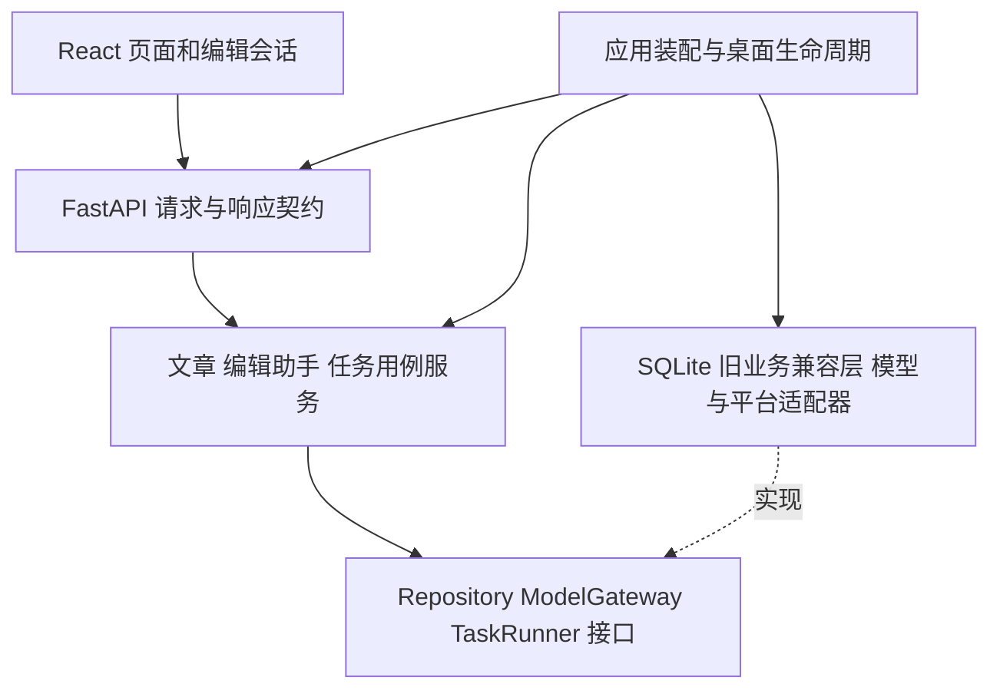

# 框架与模块边界

日期：2026-10-19。状态：M1–M3已用户验收；M4.1先接通素材、提纲与正文采用，候选验证及安装验收单独记录。目标是减少功能修改的影响范围，同时保留现有创作流程与数据兼容性。

## 技术选择

| 层次 | 选定方案 | 职责与引入时机 |
| --- | --- | --- |
| 前端 | React、TypeScript strict、Vite | M1 接入独立文章编辑页面，逐个功能替换原页面；构建后的静态资源随安装包交付 |
| 前端状态 | React reducer 管理编辑会话，TanStack Query 管理服务端查询 | 正文草稿、选区、修改建议与撤销归编辑会话；后台刷新只能更新查询缓存，不能覆盖未保存草稿 |
| 后端接口 | FastAPI、Pydantic、Uvicorn | M1 按业务分 APIRouter，统一请求校验、错误及生命周期；HTTP 层不持有业务决策 |
| 业务服务 | Python 模块化单体，显式构造依赖 | 文章、编辑助手、任务分别有用例服务；服务通过窄接口协作，不传入万能 Studio 对象 |
| 数据 | SQLite；SQLAlchemy 2.x 数据访问，Alembic 迁移 | 保留数据库格式与原表。先通过 Repository 包装旧访问，后逐表迁入；M1 不强制切换全部 SQL，也不重建旧库 |
| 后台执行 | SQLite 持久化任务记录＋进程内 worker | M3增加类型化任务查询、操作日志与执行保护，原任务表通过适配器读取；任务不是 FastAPI 请求结束后随意丢失的内存状态 |
| 模型 | 现有自选 API，经 ModelGateway 适配 | 保留分功能模型、请求快照、超时、流式接收、错误分类；不引入 Agent 登录要求 |
| 平台 | 每平台适配器与能力/回执契约 | 分开上传、草稿保存、可用性核验、公开发表，不由一个 success 布尔值代表所有结果 |
| Windows | 现有 pywebview/WebView2、pystray、PyInstaller、Inno Setup | 验证版独立 AppId、程序名、目录与实例锁；沿用已有桌面壳能力，先不更换 Electron/Tauri |
| 检查 | pytest、Playwright；新前端增加 Vitest、TypeScript 检查与 ESLint；新 Python 模块增加 Ruff | 保留既有测试，按迁入范围增加契约、状态及组件测试；Windows 安装包单独验证 |

M1 已在独立虚拟环境验证并锁定运行依赖与 npm 包，见 `requirements-preview.txt` 和 `frontend/package-lock.json`。旧运行环境保持原样。Node.js 仅用于开发构建，普通使用者不需要额外安装。SQLAlchemy/Alembic 与统一任务协议尚未接入，M1 通过兼容 Repository 复用原保存事务。

SQLite 继续作为本地存储；目前不增加 PostgreSQL、Redis、Celery、微服务或云端新服务。调度器保留业务所需的持久化与防重复规则，不追求实现通用分布式工作流平台。

## 依赖方向

接口层负责身份、同源限制、会话令牌、输入大小、类型和响应格式；业务层负责“能否保存、采用、重试”；数据层负责事务与持久化。模型、平台与文件系统调用通过适配器实现。外部请求不得在数据库写事务中长时间等待。

初期新增目录为 `frontend/src/features/editor`、`frontend/src/features/assistant`、`frontend/src/features/tasks`，以及 `studio/api`、`studio/application`、`studio/domain`、`studio/infrastructure`。现有 `studio/*.py` 与 `web/` 暂作兼容区，不在 M0 批量搬文件。新模块不得直接读另一个模块的 DOM、模块全局变量或私有任务队列。

## 文章编辑与侧边 AI

一个编辑会话绑定文章 ID、已保存版本、编辑会话 ID 和本地修改序号。用户输入是唯一的草稿来源；重新获取文章、后台状态轮询与迟到保存响应不能直接覆盖用户刚输入的内容。

保存携带基准版本，在同一事务中完成版本检查、原稿写入与版本记录。保存响应只确认本次提交的草稿；发送期间继续输入时，新的内容仍保持未保存。冲突保留本地文本并明确提示，不用最后一次写入静默覆盖。

AI 请求捕获发送时的未保存正文、处理范围、素材/画像快照与编辑会话标识。返回结果关联原请求，不因切换文章而显示在另一篇。讨论不改稿；采用先进入编辑区；旧建议或撤销不得覆盖后续人工修改。提纲确认、正文采用、保存及送稿准备保留各自既有边界。

服务端查询缓存与本地草稿分离。TanStack Query 的重新获取或缓存失效不能被视作重置编辑器的命令。首期保留 Markdown 内容格式和既有媒体引用；富文本编辑器另行评估，避免在重构中同时改变正文格式。

## 任务状态与恢复

统一的是任务身份、状态展示、执行占用、错误、回执和恢复协议，不是把所有业务状态压成同一张表。保留原任务 ID、输入快照、确认点和历史记录。

任务状态由服务端保存。客户端可以中止轮询，不等于取消服务端任务；取消是否完成需服务端确认。每次执行有独立 run token，完成写入核对 token、版本和任务状态，过期执行结果不覆盖重试后的新结果。

首次迁移保持现有并发约束。只有明确证明某类任务互不干扰后才增加并行度。重启保留中断和待处理状态，不自动重跑需要用户确认的生成。平台送稿结果未知必须核对，不能套用通用网络重试。

## 数据与渐进替换

同一数据目录只允许一个业务写入实例。新旧界面可通过同一个应用服务和数据访问入口共存，但不能各启动一个 worker 抢同一任务；初期的独立验证版使用自己的库。

Alembic 接管前需列出旧初始化建表/改表逻辑，识别旧 schema 并验证基准；不能只写版本标记就跳过结构核验。迁入的表关闭对应旧 DDL 路径。SQLite 表重建、外键、索引、媒体路径、历史版本及未知送稿记录要有升级演练。回退使用对应备份和旧安装包，不假定数据库降级天然安全。

原鉴权、Host/Origin 检查、令牌、CSP、请求大小与路径限制作为接口兼容契约迁移。换 FastAPI 不等于自动保留原安全边界；每个路由迁入时必须验证原拒绝行为。

## 参考

以下是框架机制依据，纸飞机的具体边界是本次项目设计选择：

- [FastAPI 按模块组织应用](https://fastapi.tiangolo.com/tutorial/bigger-applications/)
- [React 逐步接入已有项目](https://react.dev/learn/add-react-to-an-existing-project)
- [TanStack Query 服务端状态管理](https://tanstack.com/query/latest/docs/framework/react/overview)
- [SQLAlchemy 事务管理](https://docs.sqlalchemy.org/en/20/orm/session_transaction.html)
- [Alembic 的 SQLite 批量迁移](https://alembic.sqlalchemy.org/en/latest/batch.html)

## M3落地补记

M1/M2已用户验收。M3以TaskService/TaskRepository协议统一查询与显式恢复，既有任务表和worker仍是唯一执行来源。送稿增加ExecutionLease校验，恢复操作有持久化编号与版本检查；原AI管理器令牌规则保留。任务中心没有重建业务任务表，没有提前接管SQLAlchemy/Alembic，也没有移植媒体生产和指标采集；这些仍按后续阶段评估。具体边界与证据见M3实施记录。

M4.1补充：新创作视图通过CreationService/CreationPort/LegacyCreation连接原WorkflowManager，素材仍保存为原格式文章；仅新增素材请求回执表防止重试重复导入。文章保存增加可加入调用方事务的连接参数，原独立保存事务保持。采用在同一事务中检查当前稿版本、候选签名并保存文章修订与采用标记；未重建原库或启用SQLAlchemy/Alembic整体迁移。

2026-10-20最新验收：用户明确反馈“这次测试没问题了，M4.1验收通过”，M1–M4.1用户整体验收完成，包含本轮关闭习惯与文章管理补齐；未逐项反馈的特殊分支不补造人工实测。原失败、截图与修正记录保留。用户授权继续M4.2封面与正文配图，见[实施与交付](milestones/04-images-implementation.md)。M4其他单元和M5仍未整体完成。
