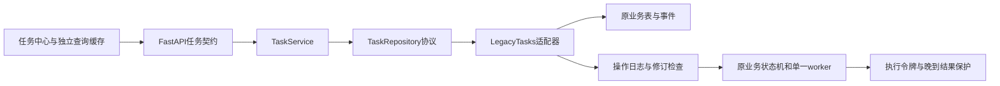

# M3 任务状态与人工恢复

用户确认 M2 验证无问题后授权本阶段：保留现有数据和配置，回归后交付同名覆盖安装包，同时更新步骤与 Wiki。当前实现版本 `0.3.0-m3.1`、安装版本 `0.3.0.1`；完整回归与成品核验已完成，普通覆盖安装由用户确认，M3用户验收待确认，M4未开始。

## 实现与模块边界

文章顶部“任务中心”打开独立视图，编辑器继续挂载。TanStack Query轮询查询与详情，按任务类型、状态范围、标题/要求/编号及当前文章筛选；保留所选记录和滚动。关闭任务中心不取消任务，不保存或重置未保存正文、AI输入。查看当前所属文章只关闭面板，切到其他文章仍沿用原未保存离开保护。

React `features/tasks` → FastAPI `api/tasks.py` → `TaskService` → `TaskRepository`协议 → `LegacyTasks`适配器。查询采用显式响应白名单，不返回任务输入快照、模型连接、凭据或执行令牌。按原业务表读取，不复制为另一套任务或再启动worker。送稿继续由原调度器处理，AI仍由原业务管理器处理；并发约束保持。SQLite/旧Repository仍在使用，SQLAlchemy/Alembic整体接管不属于本阶段。

首期覆盖14类业务记录：编辑助手、文章创作、渠道送稿、选题、平台改编、配图计划、图片候选、平台图稿、审稿、复盘、送稿补齐、创作对话、画像学习、公众号送稿检查。以“类型＋原编号”标识记录。同一篇文章可以同时有检查、生成、候选和送稿记录，数量不等于模型调用次数；不把原有状态挤进一张总任务表。已归档配图和回收站送稿保留在原工作台，不混入活动任务查询。未知状态只展示为需处理，不提供猜测的恢复动作。

讨论完成显示“已回复”；修改稿、提纲、图片与平台草稿保留各自确认含义。公众号检查交接到送稿后显示“已交接送稿任务”，不永久误报执行中。无次数字段的旧记录返回空值，不伪造执行次数；平台图稿的时间沿用所属改编并标明，送稿检查没有单独创建时间。失败分类区分配置/权限、临时问题、结果格式、中断与送稿未知，仅供处理提示，不据文字自动重发。

## 恢复与执行保护

可恢复类型委托原管理器：创作、选题、改编、审稿、复盘和文字编辑助手使用原输入快照及原ID；允许取消的任务沿用原状态机。改图、补齐、对话中的多步骤动作及经验审核等仍转到原工作项核对，不提供笼统的一键重放。任务中心不直接确认提纲、不采用正文、不公开发表。旧工作台的创作/队列支持按原任务编号直达，关闭后不被后台刷新反复打开。

`task_commands`只保存恢复操作的编号、指纹和结果。请求携带当前记录修订指纹及独立操作ID；重复相同请求返回已有结果，编号更换内容或陈旧状态被拒绝。执行前持久化pending，后续成功或失败落盘；服务中断而未确认的操作标为unknown，不自动重放。网络回执不明时前端保留同一操作ID，避免用户再次点击派发另一份。旧业务仍在自己的事务中检查状态。

原送稿表兼容增加 `run_token`，旧字段、稿件、快照、回执与历史保留。`ExecutionLease`区分每次执行；结果和失败写入核对当前令牌。较新私人候选中的送稿晚到保护已逐项核对迁入，未合并私人Git历史、媒体生产或指标采集功能。中断晚到回执保留线索；若同一次旧请求在重试尚未开始时才返回，重新转为待核对并暂停重发。已有新执行时不覆盖其结果。保留上传后的最新快照，不用旧快照覆盖核对证据。只读微信核对也检查核对期间的任务变化。

外部送稿运行中退出或重启后为“结果待核对”，不能取消或直接重试。支持的已有草稿编号可只读回查；无法自动确认时，必须使用者到原平台核实并主动勾选“确实未收到”，再标记失败，之后另点重试。标记本身不发送。已明确排期的未开始送稿仍按原计划；本地专栏的幂等写入仍可恢复，不套用外部未知送稿重发。

验证版启动在任何worker之前把上次尚未完成的排队创作/补齐转为中断，不自动重新调用模型；其他管理器原有中断逻辑保留。此补正限定预览生命周期，原兼容版独立启动的排队行为没有被全局重写。需要提纲确认时仍停在确认处，已有确认提纲继续沿原规则使用。

## 验证与交付

M3新增20项专项已通过，覆盖14类投影、分页与筛选、同ID恢复、操作去重与并发、陈旧操作拒绝、未知送稿核实、中断操作不重放、模型晚到、送稿旧令牌、晚到回执暂停重试、SQLite备份恢复、旧表加列与真实PreviewService重启。真实Chromium验证运行到回复、未保存编辑/未发送输入保留、筛选、同任务重试停在提纲确认、原任务直达、未知送稿无直接重试和窄屏。

首次专项14通过/2失败，原因是测试把新建返回值与数据库完整行直接比较，后者多出旧有的legacy_key空值；改为对完整数据库行作前后比较后16项通过，补充升级/核对竞争/实际重启后19项通过，新增浏览器后20项通过。一次前端构建在次数改为可空后发现未完成空值判断，修正未知次数与已记录0次的分支；前端12项、lint、类型和构建已通过。上述失败证据保留。

完整回归 **1091通过、6跳过、0失败**，另336个子测试通过，777.02秒。跳过为3项Windows符号链接权限条件与3项本机未安装Gitleaks；远端安全CI单独处理后者。1项警告来自测试依赖的TestClient弃用提示，本轮未为此升级依赖。前端12项、lint、类型及生产构建通过，新增浏览器流程已包含在最终全量回归内。CI增加M3测试文件的Ruff检查；本地新模块和既有预览范围Ruff通过。

最终冻结入口、26个关键Python模块与71份静态资源匹配源码。成品启动、文章/侧边/配置/任务接口、安全限制、CLI不导入正式配置、保存重启、原任务中断保留、未确认恢复命令不重放和SQLite完整性通过。安装包 `03-tasks-implementation.md`，31,405,609 字节，SHA256：`d7124bc75fe2510c97e42ef740e35a8da05f6a010aaad95e9b3062e55841da26`。升级助手与应用身份未变，沿用前期两个隔离安装目录的精确进程匹配、数据保留与拒绝数据目录证据。

当前M2运行库已做一致性业务备份：1篇文章、3条修订、2条编辑对话、1份画像、1个媒体文件，当前送稿/创作任务为0。配置JSON与媒体逐项哈希一致；SQLite完整性通过。未复制正在使用的浏览器目录，安装不清理该目录。本轮构建和测试未改写运行库，备份时该库仍无M3新增列。回退使用此业务备份，浏览器目录继续保留原位置。

安装保持固定“纸飞机架构验证版”、原AppId、EXE、安装目录和验证库；普通向导点击安装后才按完整路径退出旧验证版。同名覆盖不清除配置、文章、媒体和对话；正式版独立。构建及回归使用隔离合成数据，没有操作用户原稿或真实平台。M2原配置复用机制保持，新增任务中心不要求重新配置。

本轮原始日志、截图与故障注入保存在Git忽略的 `test-results/m3-*`。安装向导打开、实际安装、用户体验验收分别登记。回退先退出验证版，使用本轮业务备份和M2.5安装包；不用直接删除新表或执行数据库降级来代替恢复。当前M3用户验收待确认，M4未开始。
