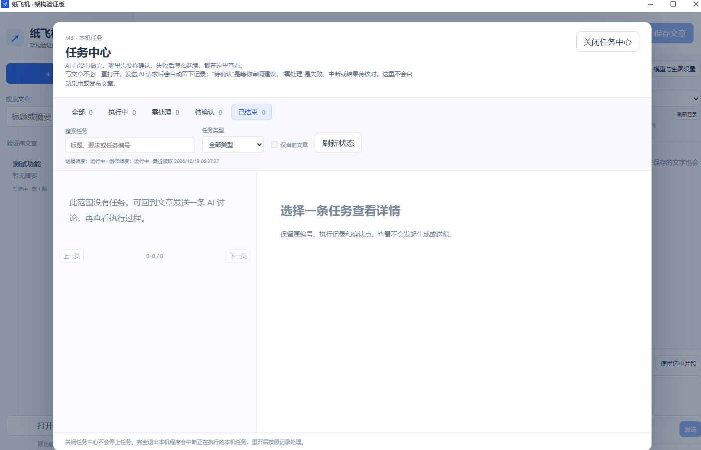

# M3：查看任务历史与排查空列表

适用M3架构验证版任务中心；M4.1继续保留该入口。M3已于2026-10-19获用户整体验收确认，完整操作与恢复边界见[M3验收单](../architecture/milestones/03-tasks-acceptance.md)。

## 怎样查看和测试

| 编号 | 你来操作 | 应看到的结果 |
| --- | --- | --- |
| M3-H01 | 保存测试文章，在侧栏“仅讨论”发送一条要求 | 产生一条有原编号的编辑对话记录，原稿不因讨论改变 |
| M3-H02 | 点顶部“任务中心”，选对应记录 | 可查看状态、要求、结果和原编号；查看本身不调用模型 |
| M3-H03 | 切换全部/已结束等状态，清空搜索和类型条件，检查“仅当前文章”范围 | 列表按范围过滤；无匹配时显示为空，切换过滤不删除原记录 |
| M3-H04 | 保存需要保留的文字，完全退出，从桌面或开始菜单重开，再查看同一记录 | 原编号与结果保留，不因重开重新生成 |

发送讨论会调用已有模型。测试无需故意制造故障或向平台送稿。

## 用户反馈截图：昨天的历史今天找不到

来源：用户提供的原始截图，界面显示M3任务中心，截图内读取时间为2026-10-19；具体安装小版本仅凭截图无法确定。图片按原样收录。

图中选中“已结束”，全部计数也为0，左侧仍有测试文章。它记录了用户遇到的空列表现象，不能单凭这张图片推断记录已被删除，也不能把“已结束”筛选认定为本次唯一原因。

当时进一步核对发现，打包开发宿主与正常桌面启动读到了Windows隔离下的不同数据视图。已分别备份，再追加恢复历史，经桌面实例接口读取核对，之后用户确认M3通过。私人数据库和恢复日志保留在本机，公开说明见[M3实施记录](../architecture/milestones/03-tasks-implementation.md)。

## 再次出现空列表时

1. 先核对筛选条件、当前文章和应用版本，按M3-H03查看更大范围；不要为制造记录反复发送付费请求。
2. 从相同的桌面/开始菜单入口重开验证版。正式版与架构验证版数据各自保存，勿把不同应用的列表当作同一个库。
3. 若仍与昨天不同，记录启动入口、版本、步骤和截图，交由开发方核对实际数据位置与备份；不要直接清库、卸载数据或自行合并数据库。

本页保存历史问题及处理结论；新发生的问题应另建带日期的验收记录，保留首次现象与复验结果。
