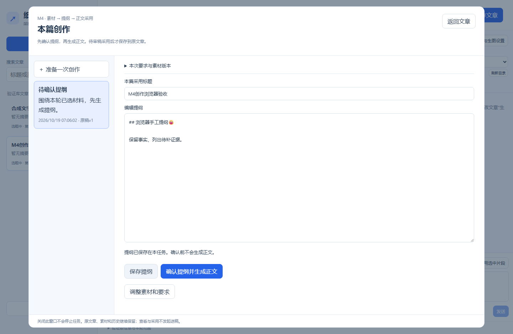
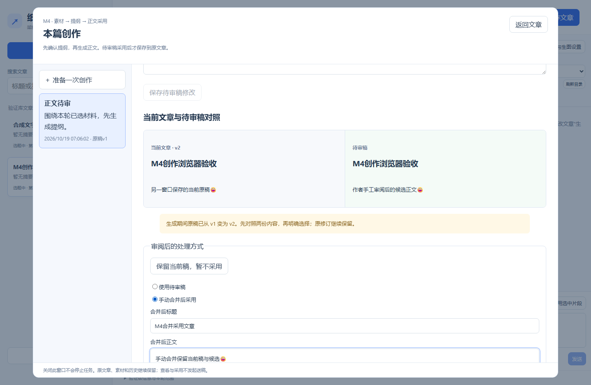
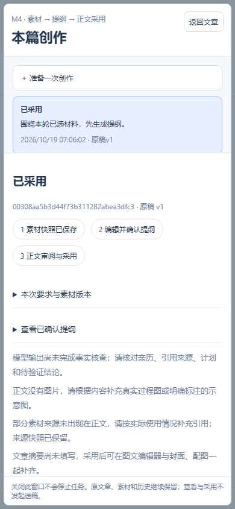

# M4.1：从素材、提纲到正文采用

适用架构验证版`0.4.0-m4.1`，安装版本`0.4.0.1`。开发方完整回归和成品核验已通过，用户最终验收待确认。安装前提见[阶段验收单](../architecture/milestones/04-creation-acceptance.md)，测试与交付证据见[实施记录](../architecture/milestones/04-creation-implementation.md)。

## 准备一篇练习文章

从桌面或开始菜单打开“纸飞机架构验证版”，核对底部版本。新建文章，标题填“M4.1验收测试”，正文填“这是原稿，采用前应保持不变。”，选好需要的账号画像，**先点击“保存文章”**。

文章保存后再点顶部“素材与创作”。后续创作会关联这篇文章的编号和保存版本。2026-10-20用户反馈已理解需要先保存文章；这条操作反馈已收录，不据此把完整流程标为验收通过。

练习素材可以直接粘贴：

> 纸质笔记整理实验：准备三份笔记，按主题分类，提取每份的关键事实，最后手动核对来源。此次只是流程练习，没有统计节省时间，也没有测量准确率。

练习要求：

> 根据所选素材写一篇约300字的整理方法介绍。先说明准备，再列步骤，最后说明局限。不编造效率数据；缺少证据的地方明确说明。

生成提纲、正文及重写会调用已配置模型，可能消耗额度。查看、编辑、保存和采用本身不调用模型或送稿；本练习无需真实平台操作。

## 一次完整操作与测试

| 编号 | 你来操作 | 应看到的结果 |
| --- | --- | --- |
| M4.1-01 | 按上方准备文章并点击“保存文章”，再打开“素材与创作” | 有可关联的已保存文章；进入本篇创作面板 |
| M4.1-02 | 勾选已有文章/笔记，或展开“新增文字素材 / 导入文件”，粘贴练习素材并点“保存素材并选用” | 素材保存并被选用；最多6份；原文章和原文件不改动 |
| M4.1-03 | 填练习要求，点“生成提纲”，等待完成 | 出现可编辑标题和提纲；正文尚未生成，文章原稿仍是准备时那句话 |
| M4.1-04 | 修改提纲并点“保存提纲”；关闭面板后再打开 | 已保存提纲保留，仍等确认；不会仅因保存提纲开始写正文 |
| M4.1-05 | 核对后点“确认提纲并生成正文”，等待完成 | 任务进入正文待审；生成正文保存在待审稿中，原文章尚未被替换 |
| M4.1-06 | “修改待审稿”，改一句，再点“保存待审稿修改” | 修改保存在本任务；文章原稿仍保持 |
| M4.1-07 | 阅读“当前文章与待审稿对照”，核实内容后点“确认采用并保存文章” | 候选保存为文章新版本，任务显示已采用，原文章修订保留 |
| M4.1-08 | 返回文章，完全退出验证版，从桌面重开 | 采用的正文、素材、创作历史和任务中心原记录仍在；查看不另派发生成 |
| M4.1-09 | 查看侧边AI历史和“打开原工作台”入口 | 既有记录和入口可用，原有功能保留 |

逐项实际结果填写[本轮验收记录](records/m4.1-2026-10-20.md)。模型输出文字会变化，验收重点是确认点、保存位置、版本和数据保留，仍需人工核对事实。

### 先保存什么？

| 按钮 | 保存到哪里 | 原文章正文是否改变 |
| --- | --- | --- |
| 保存文章 | 当前文章及修订 | 保存当前编辑内容 |
| 保存素材并选用 | 素材记录和本次选择 | 否 |
| 保存提纲 | 本次任务提纲 | 否 |
| 保存待审稿修改 | 本次任务候选正文 | 否 |
| 确认采用并保存文章 | 原文章新版本及任务采用结果 | 是，采用后保存 |

## 截图对照

以下三张为2026-10-19开发方在隔离合成数据上运行真实浏览器测试时保存的界面，适用本候选版本，不是用户安装验收截图。

**对应M4.1-04/05：提纲已保存，仍需明确确认才生成正文。**

**对应采用冲突分支：另一窗口已把原稿保存为v2，页面保留两稿并允许手动合并。** 此图展示合并界面，不表示已点击采用。

**对应M4.1-08的历史查看界面：窄窗口仍可查看已采用任务与原素材版本。** 此图来自浏览器窄屏检查，不单凭图片证明桌面重启成功。

## 继续调整与常见问题

| 编号/现象 | 你来操作 | 应看到的结果 |
| --- | --- | --- |
| M4.1-10 正文不满意但结构合适 | 点“沿用已确认提纲重写” | 相同输入沿用已确认提纲；新正文仍待审，不自动采用 |
| M4.1-11 想换素材或要求 | 点“调整素材和要求”，修改后创建新任务 | 原提纲保留供调整，重新确认后才能生成；旧任务保留 |
| M4.1-12 生成期间又保存了原文章 | 采用前对照当前稿与候选，选择保留当前稿、使用候选或手动合并 | 未明确处理前不覆盖；采用后旧修订仍在 |
| 无法开始本篇创作，或提示文章未保存 | 返回编辑区，填写标题并点“保存文章”，再打开面板 | 创作关联保存后的文章；不要只保存提纲或待审稿来代替保存文章 |
| 采用前原稿还有未保存文字 | 先返回文章保存，再核对候选 | 新输入保留，不能被旧响应静默覆盖 |
| 另一页面修改了提纲或待审稿 | 按冲突提示明确读取最新版本后核对 | 旧版本不能覆盖新版本，本地未保存文字保留供处理 |
| 生成失败或完全退出造成中断 | 查看任务中心原编号、要求和错误，需要时手动恢复 | 输入和已完成记录保留，重开不自动付费重跑 |
| 暂不采用 | 点“保留当前稿，暂不采用” | 返回文章，待审稿与任务继续保留 |

无须故意破坏配置、强杀任务或真实送稿来验收。竞争条件、回滚和中断等开发方隔离回归见实施记录。文件导入支持UTF-8的`.md`、`.txt`、`.csv`；共享资料库文字可从同一面板读取并导入本地副本，源资料保持。其他文件类型继续使用原工作台入口。
