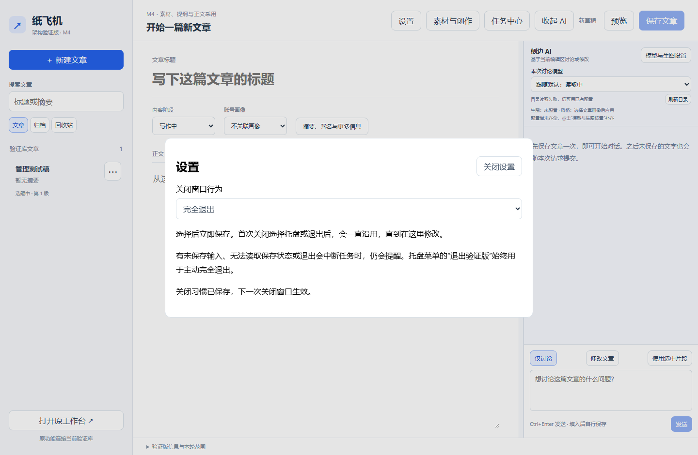
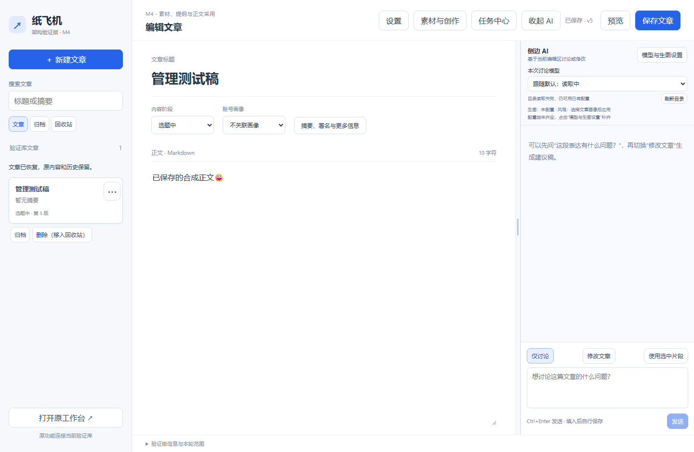
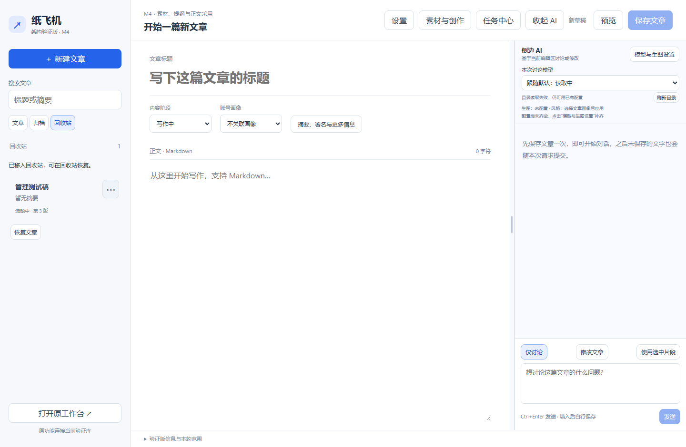
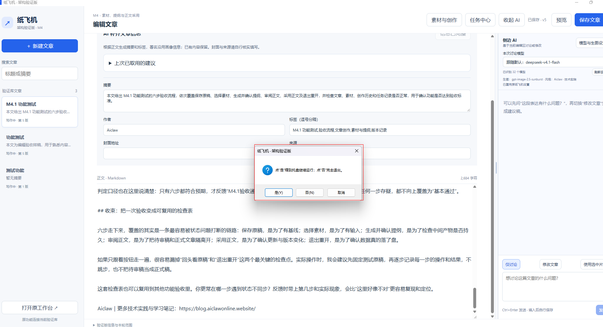

# M4.1.2：关闭习惯与文章管理

**最新状态（2026-10-20）：用户明确确认M4.1验收通过，下方保留当时的候选说明、操作及首次问题。**

应用版本`0.4.0-m4.1.2`，安装版本`0.4.0.3`。2026-10-20用户要求正常关闭只确认一次、之后沿用并可在设置改动，左侧文章提供删除及归档操作。本轮在M4.1内补齐，用户安装与最终验收待确认。[开发方实施证据](../architecture/milestones/04-creation-implementation.md)。

安装前保存当前编辑，运行`PaperPlaneStudioPreview-Setup-0.4.0.3.exe`普通覆盖向导，不用先卸载或清库。版本、文章、原修订、素材、配置和任务历史沿用验证版自己的数据目录；正式版仍独立。

## 关闭习惯：选一次，以后沿用

| 编号 | 你来操作 | 应看到的结果 |
| --- | --- | --- |
| M4.1-D01 | 保存测试文章，首次点窗口右上角关闭，选择“是” | 说明选择会被记住，软件缩到托盘，当前页面与任务保留 |
| M4.1-D02 | 从托盘打开，再点窗口关闭 | 直接缩到托盘，不重复询问正常关闭习惯；完全退出再开后也沿用 |
| M4.1-D03 | 点顶部“设置”，将“关闭窗口行为”改为“完全退出” | 选择后立即保存并显示成功提示；保存文章后关闭直接完全退出 |
| M4.1-D04 | 重开后查看设置，或改回“下次关闭时询问并记住选择” | 原习惯保留；改回询问后，下一次关闭可重新选择并记住 |
| M4.1-D05（有此情形时） | 完全退出习惯下有未保存文字或未完成任务 | 仍提醒保存风险或任务中断，可取消返回、托盘保留或明确退出，不因记住习惯静默丢稿 |

首次也可直接选“否”记住完全退出；取消不会记住选择。托盘右键“退出验证版”用于主动完全退出，即使平时关闭习惯是托盘也可退出；风险提示仍保留。设置只控制这个验证实例的关闭习惯，不更改模型或开机启动。

下图为2026-10-20隔离合成环境的真实浏览器截图，本轮不调用模型。设置与原稿分开保存，选择下拉项后等待成功提示。

## 文章列表：归档、删除和恢复

用一篇已经保存的合成测试文章练习。点击每行右侧“⋯”，或右键文章行，可展开操作选项。操作其他文章不切走当前编辑稿；处理当前文章时，有未保存输入会先提示，取消后继续保留输入。请求未结束时暂时锁定编辑区，避免操作期间新写的内容丢失。

| 编号 | 你来操作 | 应看到的结果 |
| --- | --- | --- |
| M4.1-L01 | 在“文章”列表点一行“⋯”或右键该行 | 出现“归档”和“删除（移入回收站）” |
| M4.1-L02 | 点“归档”，再切左侧“归档” | 文章移到归档列表；正文、修订、素材和任务历史保留 |
| M4.1-L03 | 点击归档文章查看内容，关闭查看后点菜单“取消归档” | 能只读核对正文；取消归档后回到“文章”，可继续编辑 |
| M4.1-L04 | 点“删除（移入回收站）”并确认，再切“回收站” | 文章从日常列表移到回收站；尚未物理删除正文、历史或附件 |
| M4.1-L05 | 回收站菜单点“恢复文章”，再回“文章”查看 | 普通文章回到文章列表；若删除前已归档，则恢复到归档区；历史和原内容保留 |
| M4.1-L06 | 完全退出再从桌面打开，核对文章所属列表 | 归档/回收站状态保留；恢复不会新建生成任务、重发平台内容或重放历史任务 |

文章有进行中的送稿任务时，沿用原归档规则先阻止操作，需从任务中心处理相关任务。其他页面已保存新版本时，陈旧菜单操作会被拒绝，刷新列表后重新核对；不会操作掉未看过的新版本。

本轮删除采用可恢复的回收站，不提供清空或永久清除。归档、删除和恢复不调用模型，也不操作平台文章。

## 本轮用户反馈原图

以下两张来自用户，界面为M4，具体小版本未在图片内显示。第一张记录普通关闭仍每次询问，第二张记录文章行缺少操作入口。它们是需求及问题依据，不能当作新版验收成功截图。

## 验收记录：2026-10-20

| 范围 | 实际结果 | 用户复验 |
| --- | --- | --- |
| 关闭习惯与回收站专项 | 22项通过；含跨实例设置读取、例外提醒、竞争操作、送稿阻止、旧库增加空回收站不改原稿 | 待确认 |
| 浏览器操作 | 设置保存重载、取消不丢输入、请求期间保护、归档只读、回收站恢复原归档状态、右键及窄屏检查通过；无模型调用或送稿 | 待确认 |
| Windows桌面 | 真实WebView2在隔离目录验证首次选择记住、再次关闭不问、重启沿用、设置API改动即时生效、托盘主动退出；对话选择由测试模拟 | 待确认 |
| 完整回归与安装包 | 1141通过、6环境跳过、0失败，另344子测试通过；前端14项、33模块/71资源和成品检查通过，专项与完整集合不相加；打开向导不等于已安装或用户验收 | 待确认 |

安装包`PaperPlaneStudioPreview-Setup-0.4.0.3.exe`，31,433,605字节，SHA256 `cbbe98895628504caf6d1a662a9a362ab1280f9ee9d2c2ed84df6109b2a5050d`。升级前运行库已一致性备份，配置与媒体哈希核对通过；测试均用隔离数据。安装、运行版本核对及实际用户验收继续分别记录。

开发过程首次浏览器测试过早读取设置加载中的默认值，第二次测试把取消后仍打开的菜单再次点击关闭；修正夹具等待与菜单状态判断后通过。成品核验曾读到尚未写完的启动标记，核验器已增加就绪内容等待，保留首次失败。原始结果留在本机忽略的`test-results/m4.1.2-*`，不覆盖失败记录。后续实际用户结果继续追加，M4.1整体未据此标为通过。

2026-10-20最新验收：用户明确反馈“这次测试没问题了，M4.1验收通过”，M1–M4.1用户整体验收完成，包含本轮关闭习惯与文章管理补齐；未逐项反馈的特殊分支不补造人工实测。原失败、截图与修正记录保留。用户授权继续M4.2封面与正文配图，见[实施与交付](../architecture/milestones/04-images-implementation.md)。M4其他单元和M5仍未整体完成。
