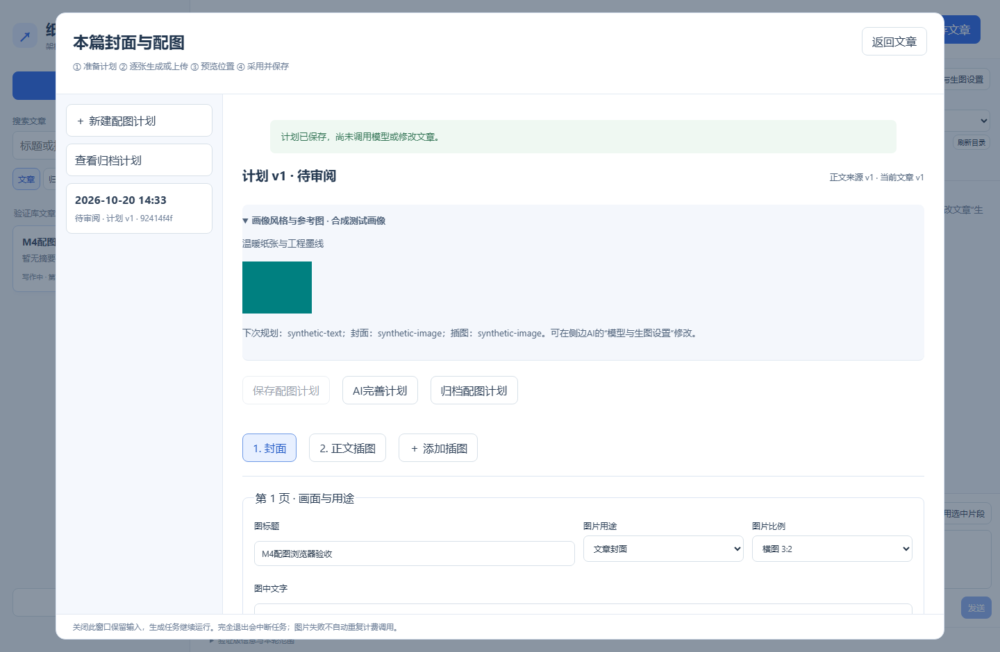
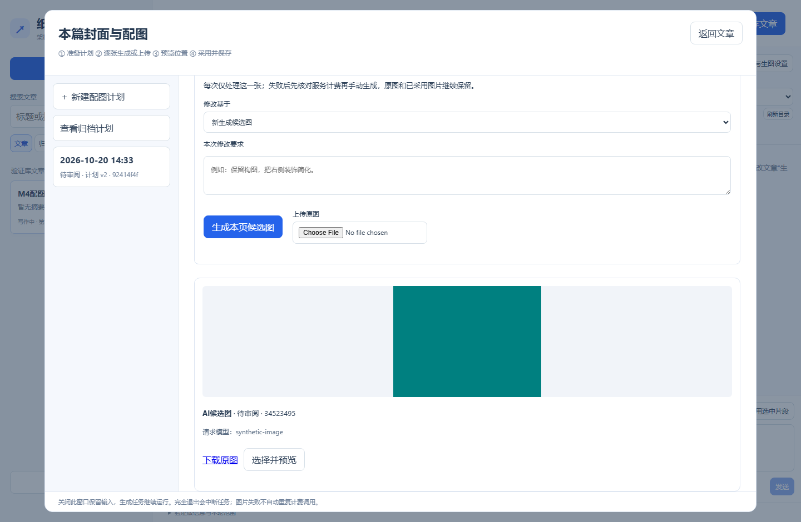
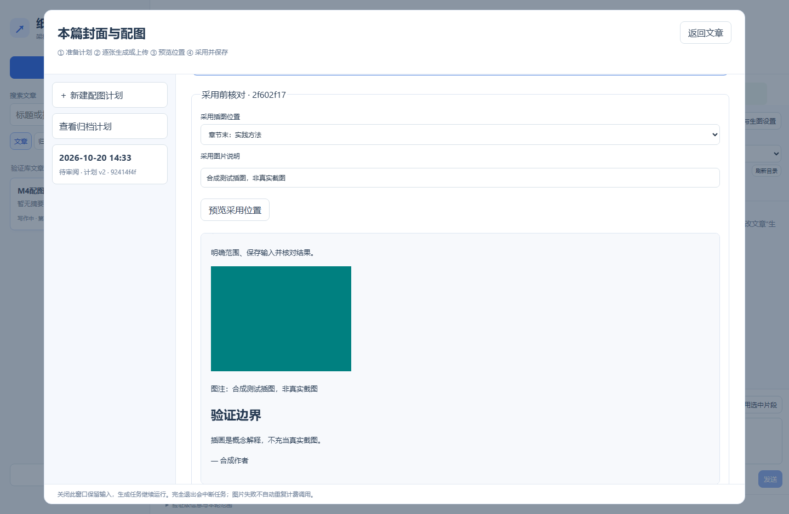
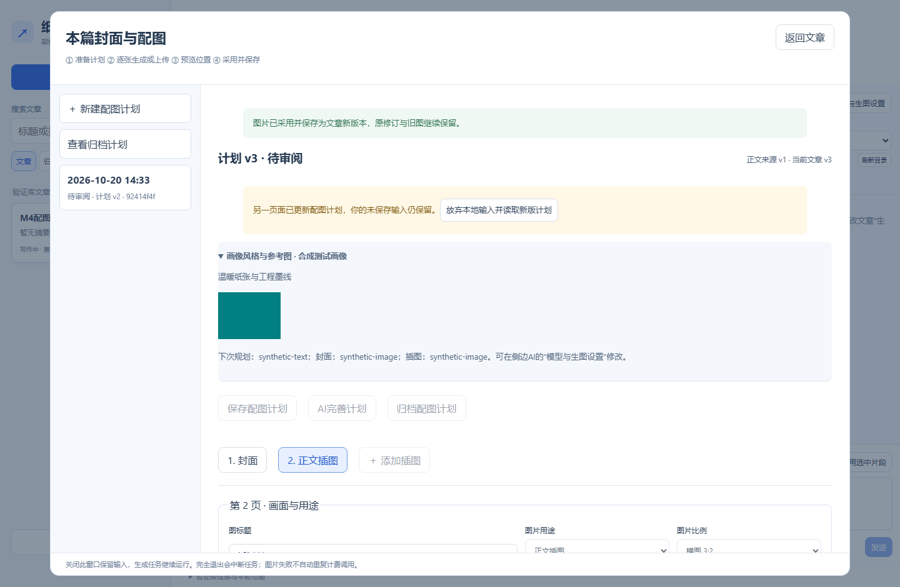
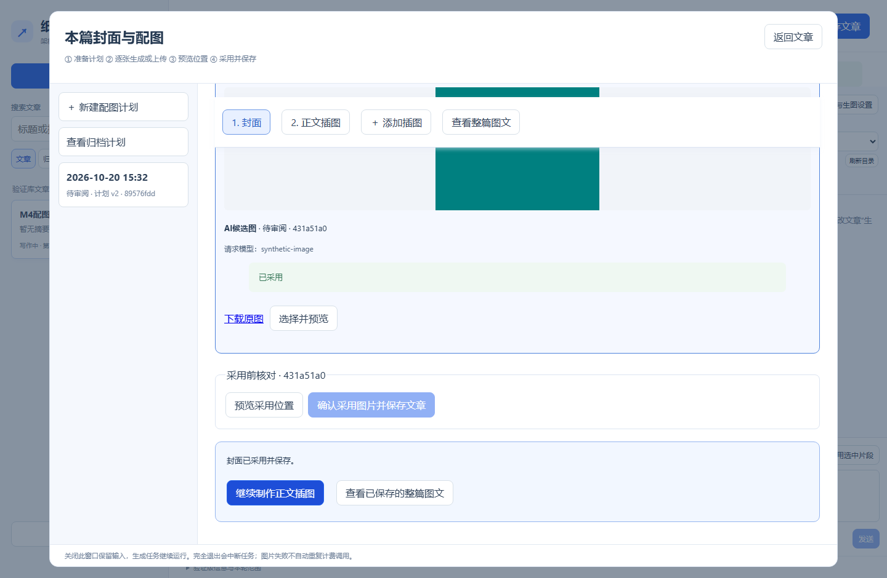
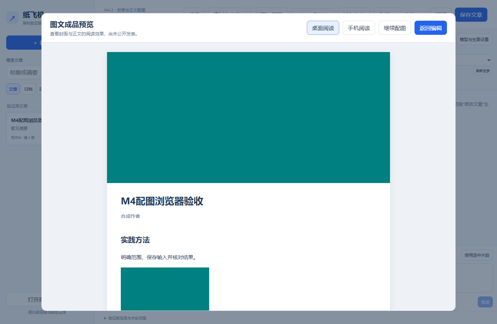
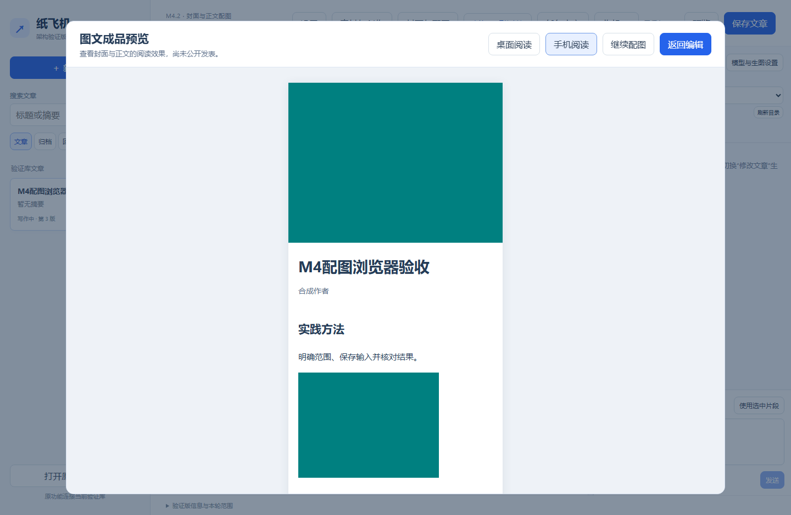
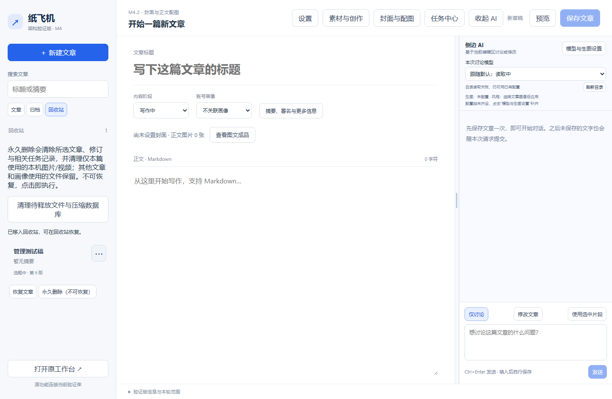

# M4.2 封面与正文配图：使用与验收

适用应用`0.4.0-m4.2.1`；安装包版本`0.4.0.5`；更新日期2026-10-20。本轮状态：**用户反馈问题已修正，待安装复验**。M4.1已明确验收通过；M4.2保留首次问题记录。

## 学会什么与准备

在新编辑器完成“计划→候选图→位置预览→采用保存→整篇图文预览”。先保存一篇正文测试文章，选用已有画像；图片模型、风格和真实参考图沿用原设置，可在侧边AI的“模型与生图设置”查看。初始计划不调用模型，AI完善计划与生成图片可能产生费用；费用说明常驻展示，点击按钮即执行，不再弹重复确认。上传原图不调用图片模型。

可复制正文：

```markdown
## 实践方法

先保存输入，检查输出，再明确采用。用清晰的步骤帮助读者理解创作过程。

## 验证边界

插画用于解释概念，真实界面与操作结果应使用原始截图，不能通过AI伪造。

— 测试作者
```

## 按步骤操作

| 编号 | 你来操作 | 应看到的结果 |
| --- | --- | --- |
| M4.2-01 | 保存正文，点击顶部“封面与配图”→“建立配图计划” | 生成封面与按正文定位的插图计划；文章版本和旧图保持 |
| M4.2-02 | 展开“画像风格与参考图” | 显示本篇画像的风格、实际参考图，以及下次规划/封面/插图模型；无画像时明确显示 |
| M4.2-03 | 修改“画面描述”、比例或图中文字，点“保存配图计划” | 计划版本增加，文章保持；可选点“AI完善计划”，需等待完成后再检查 |
| M4.2-04 | 在第1页点击“生成本页候选图” | 直接生成，不再弹费用确认；出现排队、生成与候选图片，尚未替换文章封面 |
| M4.2-05 | 点击候选的“选择并预览”→“预览采用位置” | 显示采用后的封面和当前文章版本；核对后点“确认采用图片并保存文章”才更新文章，旧修订保留 |
| M4.2-06 | 采用封面后点“继续制作正文插图”，或固定页签“2. 正文插图”；检查“计划插图位置”，生成或上传图片 | 回到本页顶部，显示位置和画面描述，再向下生成或上传。页签随滚动保留；已有采用图仍可在末尾“＋ 添加插图”并保存计划 |
| M4.2-07 | 选择正文候选，调整“采用插图位置”和说明，预览后采用 | 图片插入指定章节或段落；说明紧随图片。位置已变化时提示重新定位，不随意追加到署名后 |
| M4.2-08 | 用“上传本页原图”选择5 MB以内PNG/JPEG/WebP图片 | 原图进入候选，标明“原图未重绘”；明确采用后才写入文章，不能选原图进行AI重绘 |
| M4.2-09 | 输入尚未保存的画面描述，关闭弹窗后重开；保存计划后正常退出重开 | 弹窗关闭保留输入，桌面退出识别“封面与配图”输入；保存后不再误报。重开可从配图历史读取已保存计划、候选和采用记录 |
| M4.2-10 | 查看旧候选；可选归档及恢复计划，返回文章预览 | 历史及原图保留，归档可恢复；已有文章编辑、侧边AI、素材创作、任务中心、设置和文章菜单继续可用 |
| M4.2-11 | 配图页点“查看整篇图文”，或返回文章点“预览 / 查看图文成品” | 独立阅读窗口显示封面、标题、署名、摘要及排版后的正文图片；可切换“桌面阅读 / 手机阅读”。“返回编辑”继续修改，“继续配图”回到原计划。此操作只是预览 |
| M4.2-12 | 回收站打开测试文章菜单，点“永久删除（不可恢复）” | 点击即删除所选文章、修订及相关任务记录，清理独占本机图片/视频并显示释放空间；共享图片及其他文章保留。执行中或结果待核对任务会阻止删除 |
| M4.2-13 | 文件被占用时，之后点“清理待释放文件与压缩数据库” | 重查引用后重试释放文件、压缩数据库；不会自动清空回收站 |

## 截图与常见问题

以下截图在开发方隔离浏览器中使用合成文章与合成图片拍摄，日期2026-10-20、应用`0.4.0-m4.2`，用于说明界面；不代表用户实测或真实图片模型质量。



关联M4.2-02：显示画像风格、实际参考图和下次模型。



关联M4.2-04：候选图片可查看、下载和选择，尚未采用。



关联M4.2-07：说明和指定位置可在采用前核对。



关联M4.2-09：轮询不覆盖未保存画面描述，提供明确读取新版入口。

| 现象 | 检查与处理 | 处理后核对 |
| --- | --- | --- |
| 提示先保存正文 | 返回文章，保存标题、正文并使用写作中阶段 | 重开配图后建立计划 |
| 有参考图但服务不支持改图 | 在模型与生图设置配置images/edits能力 | 参考图确实传入，不会静默丢弃 |
| 生成失败或已中断 | 先核对服务及计费，再手动生成本页候选 | 不自动重试；旧图与文章保留 |
| 改计划后生成按钮不可用 | 先“保存配图计划”；AI完善失败时可检查并保存原计划 | 计划变为可生成状态 |
| 文章或画像已变化 | 先保存当前文章，重新预览，核对后勾选明确采用；结构明显变化可新建计划 | 文章版本匹配后才采用 |
| 编辑器版本与预览不同 | 返回文章，点“重新读取”，再重开配图 | 本地未保存稿需先保存或明确放弃 |
| 原采用图块已被手动修改 | 先到文章中核对原图与说明 | 系统保留手写修改，不静默替换或移动 |

## 验收记录

实际结果、问题与复验记在[2026-10-20记录](records/m4.2-2026-10-20.md)。开发方证据及安装包哈希以[实施记录](../architecture/milestones/04-images-implementation.md)为准；M4.2用户验收待确认。

## M4.2.1 修正后的界面

以下为2026-10-20开发方隔离浏览器、`0.4.0-m4.2.1`的合成数据截图，已查看核对。色块是测试图片，证明显示与位置，不代表生成质量。用户原始五张反馈图含私人正文，留存本机证据，不公开上传。



M4.2-05/06：底部明确显示“继续制作正文插图”；顶部页签随滚动保留。



M4.2-11：封面和正文图片显示在独立阅读窗口，编辑框不混在预览中。



M4.2-11：相同内容可切换手机宽度。



M4.2-12：菜单明确标出不可恢复，正文旁显示释放范围；点击不再追加一次确认。

本轮问题、修正和复验见[M4.2.1反馈记录](records/m4.2.1-feedback-2026-10-20.md)。
