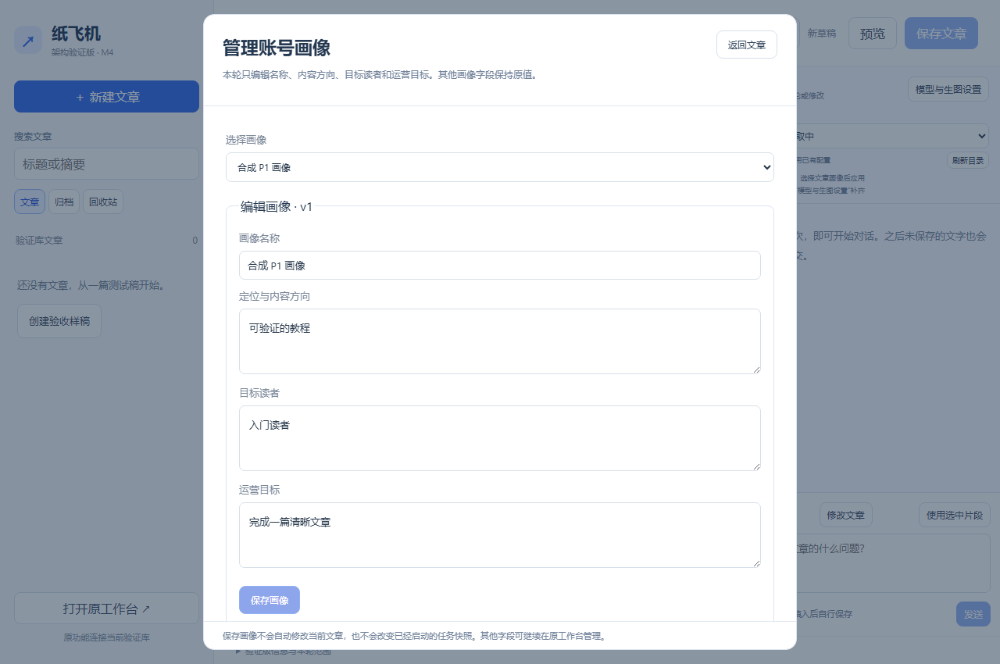

# M4.3.1 / P1.1 账号画像核心字段：使用与验收

适用开发候选：`0.4.0-m4.3.1`；安装包：`PaperPlaneStudioPreview-Setup-0.4.0.7.exe`；更新日期：2026-10-21。

本轮状态：2026-10-21用户确认“测试验证通过”；没有提供各步骤的单独结果。P1按最小范围推进：只把画像名称、内容方向、目标读者、运营目标的查看、新建和编辑入口带入新版编辑器。画像其他字段继续沿用原工作台；不新增选题、长期规则或跨端同步。

## 学会什么与准备

打开架构验证版的新版文章编辑器。可以使用合成名称“测试画像 P1”，以及合成方向、读者和目标；不需要模型调用或平台账号。画像保存和文章关联是两步：在“管理画像”保存后，要在文章的“账号画像”下拉框选择，并点击“保存文章”。

## 按步骤操作

| 编号 | 你来操作 | 应看到的结果 |
| --- | --- | --- |
| M4.3.1-01 | 点击“管理画像”，选择“＋ 新建画像”，填写四个字段并保存 | 提示画像已保存，新名称出现在画像列表；当前文章不会自动关联 |
| M4.3.1-02 | 返回文章，在“账号画像”选择刚才的画像，保存文章并重新打开 | 选择仍在；画像和文章各自保存 |
| M4.3.1-03 | 再次管理该画像，修改一个核心字段并保存 | 再打开能看到新值；旧画像的风格、红线、署名及参考图等其他字段不应被清空 |
| M4.3.1-04 | 修改画像但未保存，尝试关闭窗口或切换文章 | 提示未保存输入；选择取消后输入仍在 |
| M4.3.1-05 | 另一页面先保存同一画像，再从旧页面提交 | 提示版本冲突，旧页面输入保留，服务器的新版本未被覆盖 |

版本冲突后需要核对两份内容，再主动编辑并保存。画像修改不会重写已启动任务的快照。新建同名画像会被拒绝。所有测试请用合成内容，不要用私人运行库做自动化。

截图为2026-10-21开发方隔离浏览器合成数据，应用源码候选`0.4.0-m4.3.1`；显示四字段布局与保存提示，不代表用户安装或实际账号内容验收。

## 验收记录

开发方自动证据、安装和用户逐项反馈见[本轮记录](records/m4.3.1-profiles-2026-10-21.md)。用户没有逐项反馈的步骤维持“未测”。
