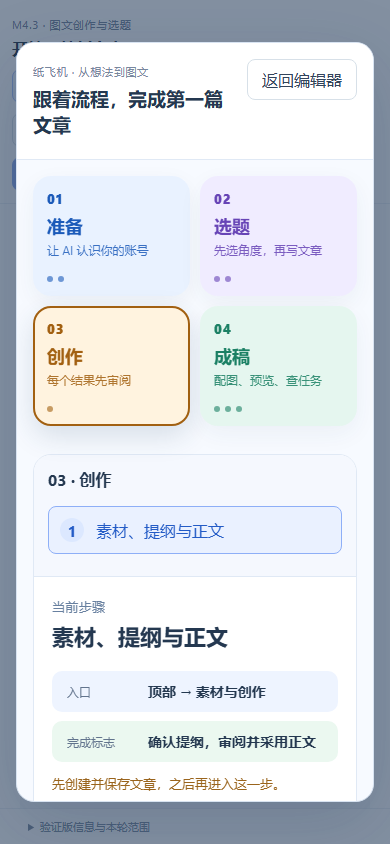

# M4.3.2 补齐：新手入门视觉模块

适用修订候选`0.4.0-m4.3.2-tasks`；安装包`PaperPlaneStudioPreview-Setup-0.4.0.10.exe`；更新日期2026-10-22。旧候选`0.4.0.9`的G04描述已按用户截图纠正。用户要求引导是应用内独立模块与按钮，视觉直观展示流程，并在后续功能增改时同步更新。

## 按步骤操作

| 编号 | 你来操作 | 应看到的结果 |
| --- | --- | --- |
| M4.3.2-G01 | 在新版编辑器左侧“新建文章”下方点“新手入门” | 独立弹窗展示“准备→选题→创作→成稿”四段流程，不遮挡为普通文档页 |
| M4.3.2-G02 | 点“选题”，再点“前往这一步” | 引导关闭，打开“帮我选题”；没有自动生成或创建文章 |
| M4.3.2-G03 | 重新打开引导，点“准备→建立账号画像→前往这一步” | 打开画像管理；没有自动保存画像 |
| M4.3.2-G04 | 不选文章或新建但尚未保存时，打开“新手入门”，选择流程阶段“创作”中的“素材、提纲与正文” | 说明需先保存文章，“前往这一步”禁用；“创作”是引导的阶段节点，编辑器实际按钮叫“素材与创作” |
| M4.3.2-G05 | 保存文章后，在引导选择“素材、提纲与正文”并点“前往这一步” | 打开“素材与创作”；如已有待确认提纲，直接回到该提纲，不再创建任务或调用模型；引导本身不采用或发布 |
| M4.3.2-G06 | 将窗口缩到手机宽度，再点顶部“新手入门” | 四段流程改为两列，可滚动阅读；仍能关闭和重新打开，不横向溢出 |

截图为开发方2026-10-21旧候选`0.4.0.9`隔离空白库浏览器检查，非本轮修订或用户安装实测。页面中的步骤与按钮入口由`frontend/src/features/onboarding/flow.ts`集中维护；项目`AGENTS.md`要求后续用户可见功能增改时，同一轮更新流程图、[入门页](quick-start.md)与相关测试。开发方记录见[本轮结果](records/m4.3.2-guide-2026-10-21.md)。

窄屏图来自同一隔离浏览器的390×844视口，展示流程图收排；不代表手机原生客户端已提供。
