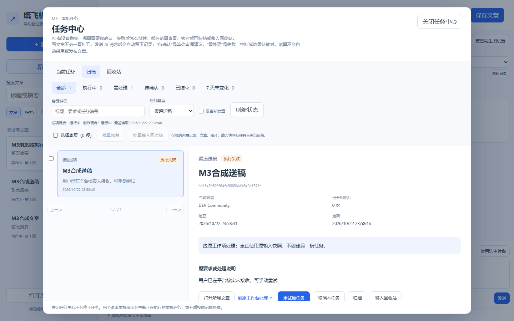

# M4.3.2 任务中心收纳：使用与验收

适用候选：`0.4.0-m4.3.2-tasks`；安装版本：`0.4.0.10`；更新日期：2026-10-23。本轮状态：开发方完整回归及冻结成品核验通过，待用户安装验收。

## 学会什么与准备

从文章顶部点“任务中心”。“当前任务”显示需要继续关注的原任务；“归档”和“回收站”保存你主动收纳的记录。收纳只改变任务中心列表，不删除文章、图片、输入快照、日志或平台回执；恢复也不自动重试。

截图中的“1 需处理”来自图片候选生成失败。点该项看失败原因，回到所属文章的“封面与配图”检查原计划；需要图片时手动重新生成，不需要时点“移入回收站”。这类图片候选没有任务中心的“重试原任务”按钮。其他“待确认”项应先在原工作项核对提纲、正文或图片，再决定归档；归档不代表自动采用。

## 按步骤操作

| 编号 | 你来操作 | 应看到的结果 |
| --- | --- | --- |
| M4.3.2-T01 | 打开任务中心，点“需处理”，选择失败的“图片候选” | 详情说明从本篇“封面与配图”检查原计划；不会自动重试或扣费 |
| M4.3.2-T02 | 选一条已核对或不再需要的非执行中任务，点“归档” | 当前列表少一条，“归档”可找到并查看原记录 |
| M4.3.2-T03 | 选一条废弃任务，点“移入回收站” | 当前列表少一条，“回收站”可找到并恢复；原文章与任务详情不删除 |
| M4.3.2-T04 | 在回收站选择任务，点“恢复到当前任务” | 回到当前列表；不会重新生成、送稿或采用 |
| M4.3.2-T05 | 勾选本页两条任务，点“批量归档”或“批量移入回收站” | 显示成功与失败数量；执行中和结果待核对的送稿任务被拒绝，不误称全部成功 |
| M4.3.2-T06 | 点“7 天未变化” | 只筛出状态仍需处理或审阅、且至少 7 天未变化的记录；不更改原任务状态，不自动删除或重试 |

可在“归档”页批量恢复或移入回收站；批量选择只作用于当前页。任务状态在另一窗口变化后，旧选择会收到冲突提示，刷新后再决定。送稿“结果待核对”必须先核对平台，不能借收纳掩盖未知结果。当前没有永久删除；回收站可恢复。

## 截图与常见问题

上图为开发方2026-10-22对`0.4.0-m4.3.2-tasks`使用隔离合成库进行浏览器检查的截图，关联T02/T04：可见“当前任务／归档／回收站”入口、归档列表和单项恢复按钮。图中的“M3合成送稿”是测试数据，不是用户任务；截图不证明用户安装验收。

用户2026-10-22提供的四张截图显示旧候选 `0.4.0.9` 的编辑器、“待确认提纲”和任务中心堆叠；它们是问题反馈，不是本轮收纳功能的验收截图。本轮新界面待安装后由用户核对。

| 现象 | 检查与处理 | 处理后核对 |
| --- | --- | --- |
| “1 需处理”一直显示 | 在“需处理”中打开失败图片候选；如仍要图片，回本篇“封面与配图”；不再需要则移入回收站 | 当前列表和顶部计数同步减少，回收站仍可恢复 |
| 批量结果有失败 | 看失败数量与提示，刷新任务状态；执行中及送稿待核对不能收纳 | 未成功项仍在当前列表 |
| 已归档任务再次进入当前任务 | 原任务状态或更新时间在原工作项发生变化，旧收纳标记自动失效 | 新活动不会被旧归档隐藏；核对后可重新收纳 |

## 验收记录

开发方合成数据验证和用户实际操作分开记录在[2026-10-22 本轮记录](records/m4.3.2-tasks-2026-10-22.md)。
