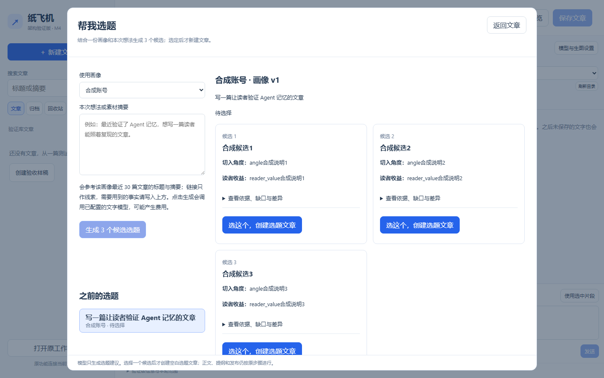

# M4.3.2 / P1.2 选题策划：使用与验收

适用开发候选：`0.4.0-m4.3.2`及视觉引导修订`0.4.0-m4.3.2-guide`；安装包分别为`0.4.0.8`、`0.4.0.9`；更新日期：2026-10-21。当前建议使用`0.4.0.9`核对选题与[新手入门](m4.3.2-onboarding.md)。

本轮状态：开发方完整回归与成品核验通过，待用户安装验收。范围只有“画像 + 一段想法 → 三个候选 → 人工选择后创建空白选题文章”。复用原有选题任务、输入快照和文章修订；参考文章勾选、共享资料直接接入、自动开始提纲和平台发布继续留在原入口或后续单元。

## 准备

打开新版编辑器，至少有一份已保存的画像。准备一段合成想法，例如“写一篇让读者验证 Agent 记忆的文章”。点击“生成 3 个候选选题”会调用已配置的文字模型，可能产生费用；查看历史、选定候选、打开文章不会再次调用模型。开发方测试使用隔离数据和合成模型响应。

## 按步骤操作

| 编号 | 你来操作 | 应看到的结果 |
| --- | --- | --- |
| M4.3.2-01 | 在新版编辑器点“帮我选题”，选画像并填写想法 | 输入保留；关闭未提交的想法时先提示 |
| M4.3.2-02 | 点“生成 3 个候选选题” | 出现可追踪的选题记录；运行时可关闭窗口，完成后展示三个候选 |
| M4.3.2-03 | 比较候选标题、角度、读者收益，展开依据/缺口/差异 | 每个候选的理由可读；历史区可重新打开本轮记录 |
| M4.3.2-04 | 选一个候选，点击“选这个，创建选题文章” | 只创建一篇空白选题文章并打开；重复同一选择不会再创建一篇，选择其他候选会提示冲突 |
| M4.3.2-05 | 模拟模型失败或中断后，点“按原输入重试” | 沿同一任务与原输入重新执行；旧文章和画像不变 |

选定候选只创建“选题中”的文章，不会生成提纲、正文或公开发布。需要继续写作时，从该文章保存资料并进入既有“素材与创作”流程。模型结果中的素材依据仍需作者核对，不代表已经抓取网页或完成事实验证。

截图为2026-10-21开发方隔离浏览器、合成账号和合成模型响应，展示候选比较与按钮位置；不证明真实模型质量或用户安装验收。

## 验收记录

开发方测试、包校验、实际安装与用户反馈分别记录在[本轮记录](records/m4.3.2-topics-2026-10-21.md)。未收到的逐项人工结果保持“未测”。
