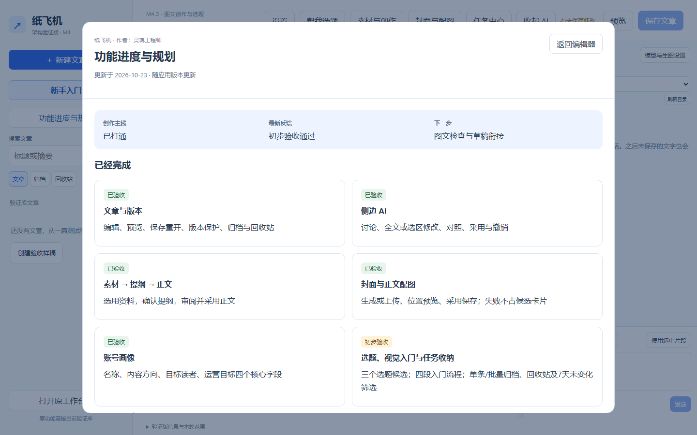

# M4.3.3 功能进度与规划：使用与验收

应用版本 `0.4.0-m4.3.3-ui`；安装版本 `0.4.0.12`；更新日期 2026-10-23。作者：灵魂工程师。本轮新模块待用户安装验收。

## 入口与用途

侧边栏“新手入门”下方点“功能进度与规划”。无需创建文章或配置模型。卡片显示已验收/初步验收功能，待开发列表按优先级显示范围和完成标志。页面仅展示纸飞机的功能进度与后续规划。查看模块不发起生成或修改文章。

窄屏可先打开“文章列表”查看侧栏，或从“新手入门 → 成稿 → 了解功能进度 → 前往这一步”进入。

## 按步骤操作

| 编号 | 你来操作 | 应看到的结果 |
| --- | --- | --- |
| M4.3.3-R01 | 无已保存文章时点侧栏“功能进度与规划” | 独立模块打开，显示作者灵魂工程师和更新日期 |
| M4.3.3-R02 | 点左侧“新手入门”下方的“功能进度与规划”；先看“已经完成”卡片，再在弹窗内向下滚动到“待开发 · 按优先级推进” | 已完成卡片带“已验收”或“初步验收”标记；待开发列表第一项为“P1 · 下一步：图文检查与公众号草稿衔接”。这是后续规划，目前没有对应的操作按钮 |
| M4.3.3-R03 | 在正文输入未保存文字，打开进度页后按Esc或返回编辑器 | 输入保留，不自动保存或发起AI任务 |
| M4.3.3-R04 | 窄屏从新手入门的成稿阶段进入 | 能打开同一模块，卡片单列排列，无横向溢出 |

进度是随应用发布的快照，离线也可查看；旧安装包不会联网自动更新此页。后续功能变化须同一提交同步进度数据、ROADMAP、新手入门和测试指南。

## 验收记录

截图来源：2026-10-23，`0.4.0-m4.3.3`隔离合成库浏览器验证；对应R01/R02，仅证明界面展示，不代替用户验收。[窄屏截图](assets/m4.3.3-roadmap/mobile.png)同源，对应R04。

[2026-10-23记录](records/m4.3.3-roadmap-2026-10-23.md)。用户本轮“初步验收通过”对应之前的M4.3.2修订，不提前代表本模块通过。
