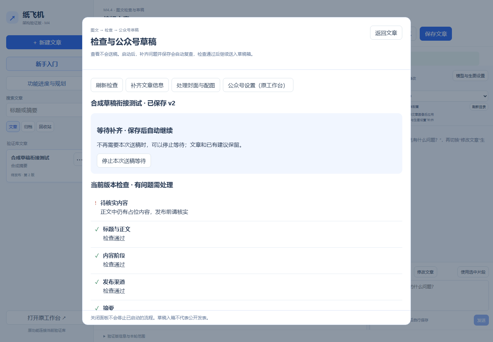
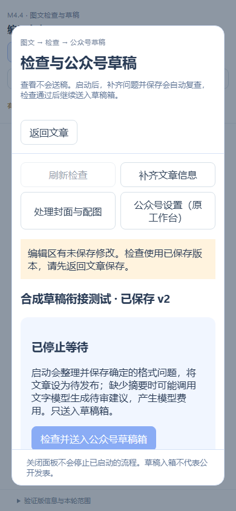

# M4.4 图文检查与公众号草稿：使用与验收

适用应用版本：`0.4.0-m4.4-drafts`；Windows安装版本：`0.4.0.13`；更新日期：2026-10-23。作者：灵魂工程师。

本轮为开发候选，待用户安装与真实公众号草稿验收。此前M4.3.3已获用户确认通过。

## 入口和准备

打开并保存一篇测试文章，然后点顶部 **检查与公众号草稿**。也可从 **预览 → 检查与公众号草稿**，或 **新手入门 → 成稿 → 检查并衔接公众号草稿 → 前往这一步** 进入。

先用标题“草稿衔接练习”、正文“[待核实] 这里放一段练习内容。”进行检查练习。补齐摘要、作者并选用真实有效的封面后，再决定是否实际送入测试公众号草稿箱。公众号API配置仍在原工作台渠道设置，面板提供入口；返回新版编辑器继续。

**打开与刷新只检查已保存文章，不修改、不调用模型、不送稿。** 点击“检查并送入公众号草稿箱”会启动已有流程：整理并保存可确定的格式问题、将文章设为待发布；缺少摘要等内容可能生成待审建议并产生模型费用。问题补齐保存后自动复查，满足条件后直接送入草稿箱，无需再点一次送稿。草稿不等于公开发表。

## 按步骤操作

| 编号 | 你来操作 | 应看到的结果 |
| --- | --- | --- |
| M4.4-D01 | 未保存文章时点顶部“检查与公众号草稿”；随后保存练习稿，再从预览进入 | 未保存时提示先保存；保存后出现版本和检查结果；查看不会产生送稿任务 |
| M4.4-D02 | 保留正文中的“待核实”，点“刷新检查” | 待处理问题排在通过项前；可返回补齐文章信息、处理配图、配置公众号 |
| M4.4-D03 | 编辑正文但不保存，再打开面板 | 明确检查使用已保存版本；启动、采用和停止等写入按钮禁用，返回后未保存文字仍在 |
| M4.4-D04 | 在可送稿的测试账号下保存练习稿，点“检查并送入公众号草稿箱” | 有占位或缺项则显示“等待补齐”；无问题则创建一条原送稿任务，状态更新为等待执行/正在处理/草稿回执 |
| M4.4-D05 | 在等待补齐时修正问题、填写摘要作者、准备有效封面并保存 | 自动复查，通过后继续同次送稿；无需重复点开始；面板显示该任务对应版本 |
| M4.4-D06 | 另用缺少摘要的测试文章启动，等待补齐建议 | 先显示建议摘要、署名及依据，可展开核对正文和图片引用；未采用前原摘要不变；点击“采用补齐建议并继续检查”才保存并复查 |
| M4.4-D07 | 在仍有问题、尚无送稿任务时点“停止本次送稿等待”，再修改保存 | 显示已停止等待；不再自动送稿。文章保留，后续可主动重新启动 |
| M4.4-D08 | 查看已有送稿结果，或从面板进入“在任务中心处理或核对” | 显示任务编号、送稿版本及草稿回执；结果待核对先核对，失败处理原任务，不创建重复任务 |
| M4.4-D09 | 另一窗口修改并保存同篇文章，再在本窗口刷新面板 | 提示版本不同，写入按钮禁用；“载入最新已保存版本”沿用未保存离开保护，不静默覆盖文字 |
| M4.4-D10 | 从新手入门进入本模块，再查看侧边栏“功能进度与规划” | 引导打开本面板但不启动；本功能标为待验收、M4.3.3规划入口标为已验收；后续平台改编仍待开发 |

## 截图

以上为2026-10-23、M4.4隔离浏览器自动测试，使用合成文章和模拟本地图文校验。证明D02/D03/D04的界面及操作状态，不代表真实公众号送稿成功，也不代表用户安装验收。

## 常见问题与范围

| 现象 | 处理 |
| --- | --- |
| 公众号配置不完整 | 从面板进入原工作台，完成渠道API设置后返回；面板刷新读取最新配置 |
| 补齐建议失败或中断 | 查看错误；可手动填入摘要作者并保存，或主动“重新准备补齐建议” |
| 补齐建议显示过期 | 文章或素材已变化；载入当前版本，再准备建议 |
| 作者建议不正确或为空 | 返回“补齐文章信息”填写真实署名并保存；不自动覆盖已有作者 |
| 已有草稿对应旧版本 | 保留原回执，不自动创建第二份。自动更新微信旧草稿、双端差异处理留待后续实现 |
| 结果待核对 | 在任务中心核对原任务；未确认前不重发，查询失败不等于微信未收到 |
| 已有成功回执但下方重复检查不通过 | 重复检查用于阻止再次发送，不改写已有成功结果 |
| 关闭面板后任务还在 | 关闭面板不停止流程；等待补齐可点停止，已排队的任务到任务中心处理 |

本轮只衔接微信公众号草稿；不新增公开发表、多平台送稿、自动覆盖微信旧稿或设置迁移。数据仍在当前验证库，使用原检查、补齐与送稿执行器。

## 反馈

按步骤编号反馈“通过 / 失败 / 未测”和现象。开发方证据、已知限制与用户反馈见[本轮记录](records/m4.4-drafts-2026-10-23.md)。
