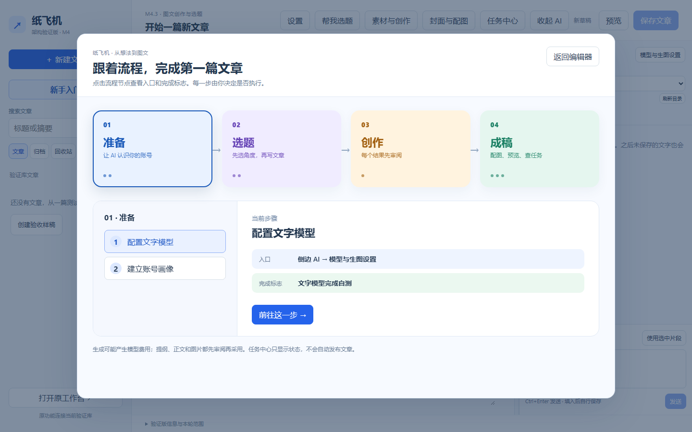

# 新手入门：在应用里看创作流程

适用修订候选：`0.4.0-m4.3.2-tasks`，Windows安装版本`0.4.0.10`。新版编辑器左侧“新建文章”下方有独立的**“新手入门”**按钮；窄屏时入口出现在顶部工具栏。点击后打开可交互的流程图。

上图拍摄于2026-10-21隔离浏览器和空白测试库，证明按钮、四段流程、步骤卡和入口提示的布局；不证明真实模型输出或用户安装验收。

## 四段路

**准备 → 选题 → 创作 → 成稿**。彩色“创作”是流程阶段，不是编辑器按钮。点它再选“素材、提纲与正文”，可看到实际入口“素材与创作”；点“前往这一步”打开该入口，已有待确认提纲时会回到原任务。模型配置会展开侧边AI，文章步骤回到标题区。没有已保存文章时，需要文章的后续步骤会禁用并说明原因。打开引导或跳转本身不会调用模型、采用内容或送稿。

第一次练习可在“帮我选题”中写“让读者验证Agent记忆的文章”，选定一个候选，核对新建的是空白选题文章，再补充可核实资料并保存。随后按流程审阅提纲、正文和图片；停止在本机预览，不必送稿。生成可能产生模型费用，只有明确点击对应生成按钮才会发起请求。

## 对照验收

- [视觉引导模块的逐步测试](m4.3.2-onboarding.md)
- [P1.2选题五步验收](m4.3.2-topics.md)
- [素材到正文的完整练习](m4.1-text-creation.md)
- [封面与正文配图指南](m4.2-images.md)

任务中心在`0.4.0-m4.3.2-tasks`候选中可单条或批量归档、移入可恢复回收站；“7 天未变化”只筛选，不自动删除。[操作与测试](m4.3.2-task-management.md)。平台草稿不等于公开发表。

2026-10-23新增：侧边栏“功能进度与规划”查看已完成、初步验收和待开发卡片、优先级与Easel更新参考。窄屏可从“新手入门 → 成稿 → 了解功能进度”进入；查看不会调用模型或修改草稿。入口随版本更新，见[操作与验收](m4.3.3-roadmap.md)。前一轮M4.3.2修订已获用户初步验收。
