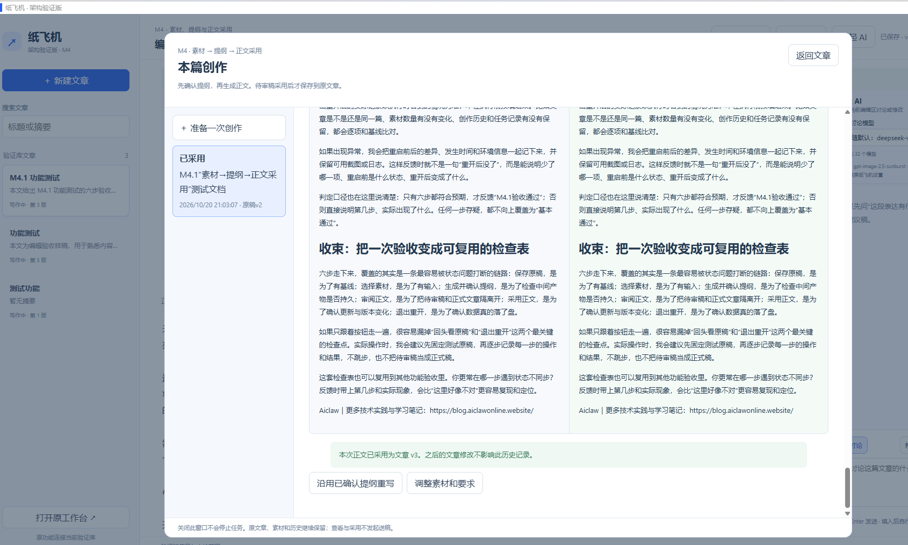
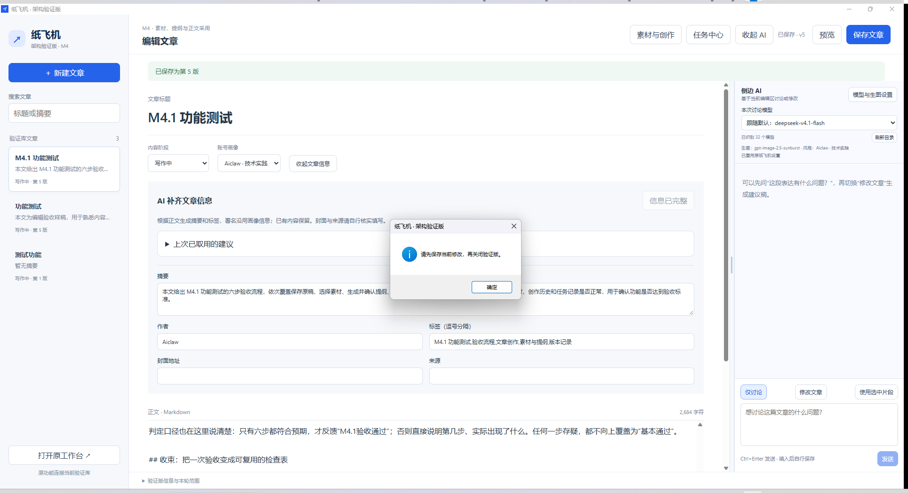

# M4.1 用户反馈：已采用保存后关闭仍被拦截

日期：2026-10-20。用户界面为M4，具体小版本未在截图内显示；反馈发生于`0.4.0.1`候选交付之后。修正候选为`0.4.0-m4.1.1`/`0.4.0.2`，用户复验待确认。[操作指南](../m4.1-text-creation.md)。

## 首次现象与用户确认

用户没有看到“保存待审稿修改”，直接点击“确认采用并保存文章”，之后又保存文章，关闭时弹出“请先保存当前修改，再关闭验证版”。用户进一步确认：是在点窗口右上角“×”时出现，没有另外填写内容。

第一张用户截图显示任务“已采用”，正文采用为文章v3。它证明这次采用保存已完成，不代表所有验收步骤都已通过。已采用历史不显示待审编辑按钮；不修改候选时可以直接采用。原指南把编辑候选写成必走步骤，已改为条件步骤。

第二张用户截图同时显示“已保存·v5”和阻止关闭的保存提示。这是桌面退出保护提示，不是新的验收界面。截图及用户反馈表明体验存在矛盾，不能归因为用户忘记保存。

两张为用户提供原图，按原样收录；内容与版本信息以图中实际可见部分为准。

## 定位与修正范围

旧桌面关闭代码把“未保存”与“状态读取异常或缺失”都归为同一条提示，并直接拦截退出。文章保存状态之外，创作面板也有独立的未保存输入检查，但原提示未说清位置。

隔离浏览器补测“未改候选→直接采用→额外保存文章→查看已采用历史”正常；本机真实WebView2对正常保存页面的读取和关闭也正常。本轮未复现用户那一刻具体哪个状态触发了旧提示，不能声称已证明是隐藏输入、读取异常或用户操作导致。

修正已保存文章被不明确提示卡住、无法选择退出的交互：

- 关闭检查区分已保存、明确有未保存输入、无法读取状态；无法读取时不再直接断言文章未保存。
- 明确有未保存输入时列出位置，例如文章编辑区、新素材、尚未提交的素材选择或写作要求；主界面也显示“创作有未保存输入”。保存文章不会擅自清除创作输入。
- 关闭时可选择缩到托盘保留当前输入、取消返回检查、或明确放弃尚未保存输入并完全退出；已保存文章保留。有活动任务时仍提醒退出会中断任务。
- 正文待审界面补充说明：仅在修改候选后保存待审稿；采用已经同时保存文章。

## 用户复验

后续用户截图已出现正常托盘/退出选择框，并要求记住习惯、设置改动及文章菜单。对应M4.1.2操作和原图见[后续补齐指南](../m4.1.2-desktop-and-library.md)；这份新增反馈不代表下表所有复验已通过。

| 编号 | 操作 | 预期 | 用户结果 |
| --- | --- | --- | --- |
| M4.1-C01 | 不改候选，直接确认采用并保存文章 | 显示已采用与文章新版本，无需另存待审稿或再次保存文章 | 旧版截图已证明采用完成；修正版待复验 |
| M4.1-C02 | 返回文章，不做其他修改，点右上角关闭 | 出现托盘/完全退出/取消选择，不显示不明确的强制保存提示 | 待复验；首次此处失败保留 |
| M4.1-C03 | 选择完全退出，再从桌面重开 | 采用正文、修订与任务历史保留 | 待复验 |
| M4.1-C04（可选） | 另填一份新素材标题但不保存，返回文章后关闭 | 主界面提示创作未保存输入；关闭说明新素材位置，取消或托盘可保留 | 待复验 |

开发方回归、成品与安装包事实追加于[M4实施记录](../../architecture/milestones/04-creation-implementation.md)。修正交互不等于原现场触发原因已完全定位；M4.1整体仍待用户确认。

开发方交付验证：1127项通过、6项环境跳过、0失败，另343子测试通过；专项25项、前端14项以及类型/lint/构建通过。真实WebView2关闭处理器在隔离数据上用合成状态和模拟对话选择验证三态与取消/退出；冻结入口、31模块和71资源核对、合成保存/重启通过。安装包为`PaperPlaneStudioPreview-Setup-0.4.0.2.exe`，SHA256 `4c3eba95fcb4395db743b9ffc7e1c57717b0bf32775e682621ae7aa6809b917e`。以上为开发方证据；用户复验栏继续待确认，无须为复验重复付费生成正文。
